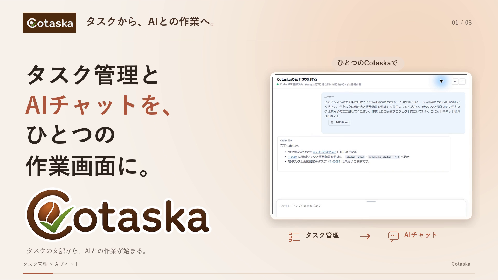
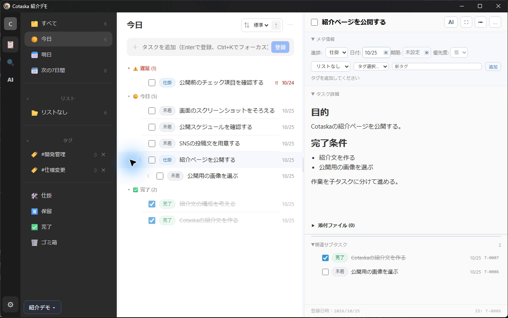
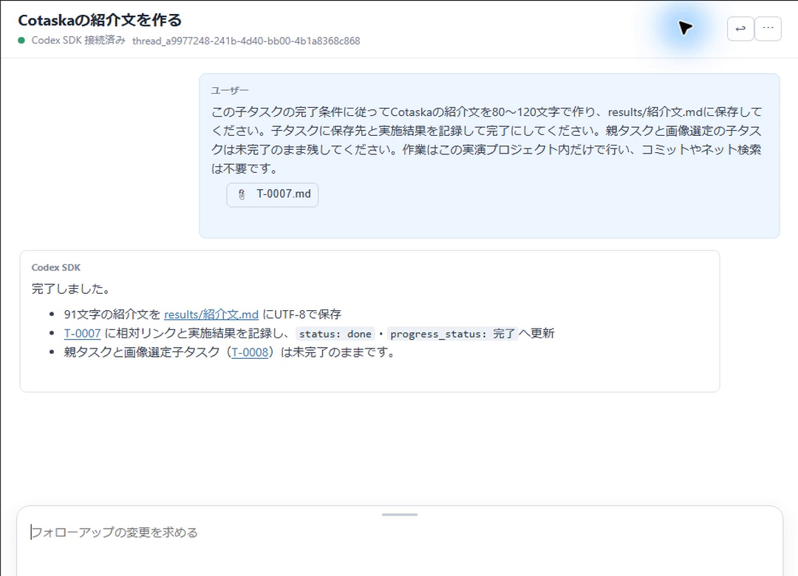
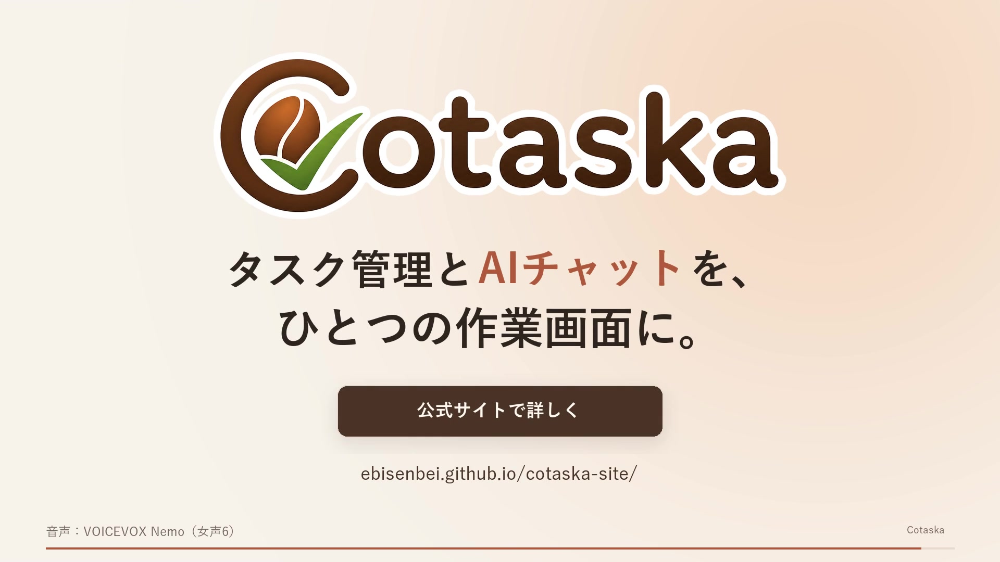

# Cotaska 公開用画像

2026-10-25、T-0294で既存画像・動画を見比べ、以下の4点を選定した。用途ごとの採用画像の正式管理先とする。
主メッセージは「タスク管理とAIチャットを、ひとつの作業画面に。」。

## 採用画像と使い分け

| 番号 | 画像 | 用途 | 選定理由 |
| --- | --- | --- | --- |
| 01 | [紹介メイン](01_紹介メイン_タスク管理とAIチャット.png) | 公式サイト・noteの紹介メイン、SNSの製品紹介 | ロゴ・主コピー・AIチャットの実例が1枚にそろい、名前と価値を同時に伝えられる |
| 02 | [タスク管理](02_タスク管理_遅延今日完了と子タスク.png) | タスク管理機能の説明 | 遅延・今日・完了、複数タスク、子タスク、目的・完了条件を実画面で確認できる |
| 03 | [AIチャット](03_AIチャット_依頼と対応結果.png) | AI連携の説明、詳しいSNS投稿の補足 | タスク添付から成果物の保存・タスク更新まで実際の依頼と結果が分かる |
| 04 | [動画サムネイル](04_動画サムネイル_v3.jpg) | 60秒紹介動画の表紙、動画紹介投稿 | 採用済みv3と同じロゴ・配色・主メッセージで動画との統一感を保てる |

初回の紹介記事は **01 → 02 → 03 → 動画** の順に配置する。SNSで1枚だけ使う場合は01、動画への誘導が目的なら04を使う。02・03は説明文を添えて、本文中の補足として使う。

## プレビュー

### 01：紹介メイン

### 02：タスク管理

### 03：AIチャット

### 04：動画サムネイル

## 掲載時の説明文

### 01

- 説明文：タスク管理とAIチャットを、ひとつの作業画面に。Cotaska。
- 代替テキスト：Cotaskaのロゴと「タスク管理とAIチャットを、ひとつの作業画面に。」のコピー、タスクから依頼したAIチャットの実例。
- サイズ：1920×1080

### 02

- 説明文：遅延・今日・完了を見分けながら、複数のタスクと子タスクを整理できます。
- 代替テキスト：Cotaskaのデモ画面。左にナビゲーション、中央に遅延・今日・完了のタスクと子タスク、右に目的・完了条件と関連サブタスクを表示。
- サイズ：1266×794

### 03

- 説明文：タスクを添えてAIへ依頼し、作成ファイルと対応結果を同じチャットで確認。
- 代替テキスト：紹介文作成の子タスクを添付したAIチャット。依頼文の下に、紹介文ファイルの保存とタスク更新の実行結果を表示。
- サイズ：1080×780

### 04

- 説明文：Cotaskaを60秒で紹介。タスク管理とAIチャットを、ひとつの作業画面に。
- 代替テキスト：Cotaskaの大きなロゴ、製品の主メッセージ、公式サイトの案内とURLを配置した紹介動画のサムネイル。
- サイズ：1920×1080

## 元素材と選定判断

- 01：紹介動画v3の4.000秒から、そのままPNGへ抽出。アニメーションの見出し・ロゴ・画面切り替えが落ち着いた場面を採用。
- 02：紹介動画用の元収録の `hierarchy_final` イベント1秒後。デモ用プロジェクトの実画面全体を無加工で抽出し、区分と親子関係の説明を1枚にまとめた。
- 03：動画制作時に実収録から切り出した `chat_intro.png` の無改変コピー。
- 04：採用済みv3のサムネイルを無改変コピー。

元画像・元動画は保持している。再抽出の時刻、元素材のパスとハッシュ、出力のサイズとSHA-256は [選定マニフェスト](選定マニフェスト.json) に記録。

既存の開発用スクリーンショット3点はT-0294添付の記録として保持する。主な紹介画像には、開発作業の長いタスク名やエディタの情報が少なく、製品の利用場面を説明しやすいデモ用画面を優先した。
Markdownのエディタ画像は保存形式を詳しく説明する記事向けの参考素材とし、初回紹介の4点には含めない。旧58秒版の紺色サムネイルは現行動画と配色が異なるため採用しない。

## 利用上の扱い

- 01・04は1920×1080の横長画像。媒体へ配置するときにロゴ・主コピーが切れないよう全体を表示する。
- 02・03は画面の文字を読むための補足画像。横長の見出し枠へ無理に切り抜かず、クリック拡大や本文中の大きな表示を使う。
- 画面内の日付・タスク数・AIの返答は収録時のデモ例。現時点の運用データではない。
- 01はテロップと実画面を組み合わせた動画の編集画面。単独のアプリ画面そのものとしては説明しない。
- 04にある「公式サイトで詳しく」は画像内の表現。掲載先では動画または公式サイトへのリンクを別途設定する。
- 今回は画像の選定・格納まで。サイトやSNSへの掲載と導線確認はT-0295などの公開工程で扱う。

関連：[紹介動画の正式管理先](../30_紹介動画/README.md)／[T-0294](../../../../../00_mgmt/Cotaska_タスク管理ツール/tasks/T-0294/T-0294.md)
